# Architecture

This page describes the physical and logical architecture of Partner Manager — how it is deployed across client infrastructure, how the management agent operates, what data is collected, and how every credential and secret is secured.

## System Overview

Partner Manager is deployed as isolated, single-tenant instances — one per client. Each instance runs inside the client's own infrastructure (datacenter, VPC, or cloud account) and is managed remotely through a centralized control plane.

The enitre solution consists of three independent components:  the control plane, the client application and a monitoring agent.

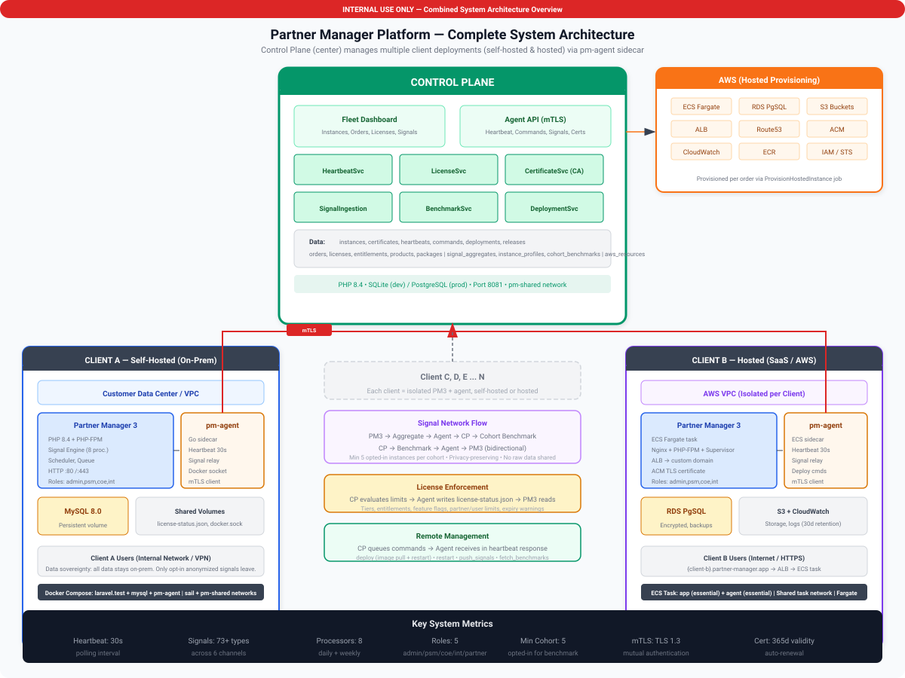

**Key design principles:**

- **Client isolation** — Each client has its own application instance, database, and agent. No data is shared between clients.
- **Pull-based communication** — The agent initiates all connections outbound. The control plane never connects inbound to client infrastructure.
- **Zero trust** — Every connection is mutually authenticated with TLS client certificates. Every deployment artifact is cryptographically signed.
- **Graceful independence** — The application operates fully without the agent or control plane. Management connectivity is additive, not required.

## Client Deployment

Each client runs exactly two containers, orchestrated with Docker Compose:

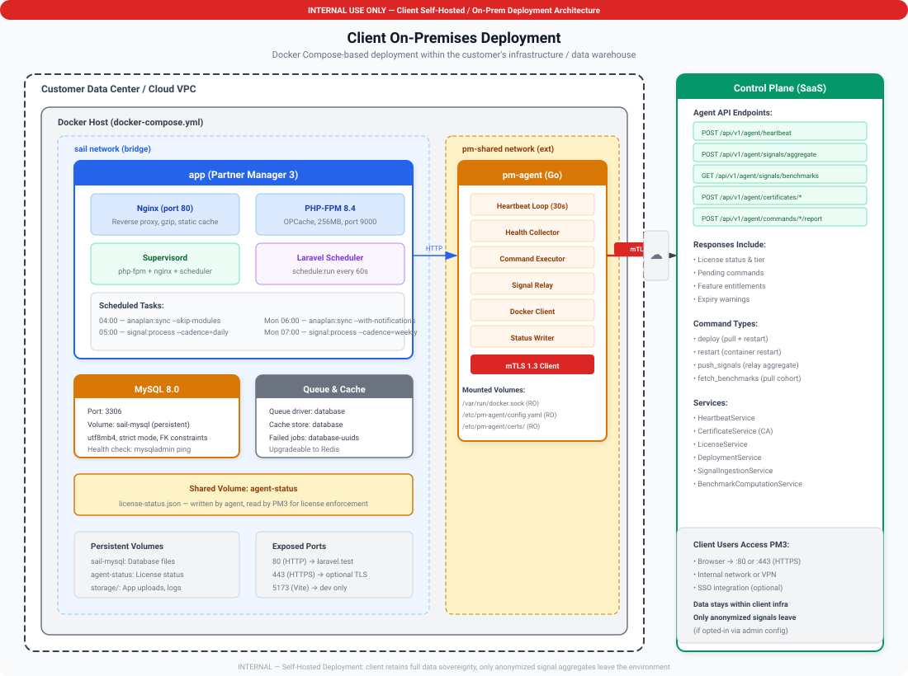

### Container Isolation

The app and agent containers are completely independent processes:

| Concern | App Container | Agent Container |
|---------|---------------|-----------------|
| **Network** | Ports 80/443 exposed to client users | No listening ports |
| **Database** | Full read/write access | No database access whatsoever |
| **Docker socket** | No access | Read-only access |
| **File system** | App storage volume | Config + certs (read-only) |
| **Outbound network** | None required | HTTPS to control plane only |
| **Secrets held** | DB credentials, APP_KEY, session secrets | mTLS certificates, instance ID |

The agent **cannot** access the app's database, file storage, or internal processes. The app **cannot** access the agent's certificates or configuration.

### Database Externalization

The application does **not** bundle a database. The connection is configured entirely through environment variables, giving clients full control over their data storage:

| Variable | Description | Example |
|----------|-------------|---------|
| `DB_CONNECTION` | Database driver | `mysql`, `pgsql`, `sqlsrv` |
| `DB_HOST` | Server hostname | `mydb.abc123.us-east-1.rds.amazonaws.com` |
| `DB_PORT` | Port | `3306`, `5432`, `1433` |
| `DB_DATABASE` | Database name | `partner_manager` |
| `DB_USERNAME` | Database user | `pm_app` |
| `DB_PASSWORD` | Database password | (client-managed secret) |

Supported services:

| Cloud | Services |
|-------|----------|
| **AWS** | RDS (MySQL, PostgreSQL), Aurora |
| **Azure** | Azure SQL Database, Azure Database for MySQL/PostgreSQL |
| **GCP** | Cloud SQL (MySQL, PostgreSQL) |
| **On-premises** | MySQL 8.0+, PostgreSQL 15+, SQL Server 2019+ |

> [!IMPORTANT]
> Database credentials are stored only in the client's environment — they are never transmitted to the agent or the control plane under any circumstances.

## Network Architecture

### Access Points

Partner Manager exposes three distinct access points, each serving a different audience:

| Access Point | Path | Audience | Authentication |
|-------------|------|----------|---------------|
| **PSM Application** | `/` | Internal PSMs and admins | Session-based (username/password) |
| **Partner Portal** | `/portal` | External partner contacts | Separate session guard (portal credentials) |
| **REST API** | `/api/v1` | External systems and integrations | Bearer tokens with scoped abilities |

Each access point uses its own authentication guard and middleware stack. The PSM application and Partner Portal share the same deployment but operate with **completely separate user pools** — internal users cannot log into the portal, and portal contacts cannot access the PSM application.

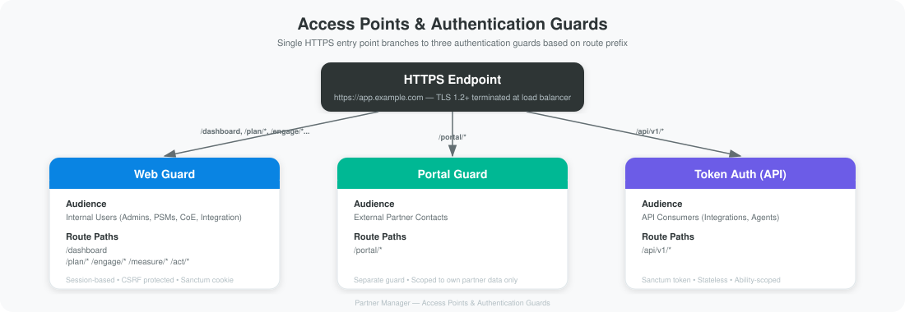

### External Integrations

| System | Protocol | Authentication | Direction |
|--------|----------|---------------|-----------|
| **Application** | HTTPS REST API | Stored credentials + JWT | Bidirectional |
| **Salesforce** | OAuth 2.0 | Stored credentials | Import |
| **CSV/Excel** | File upload | API token | Import |
| **Control Plane** | HTTPS (mTLS) | Client certificate | Outbound only (via agent) |

## The PM Agent

### Purpose

The agent is a lightweight, statically compiled binary (~10 MB) that runs as a sidecar container. It is the sole bridge between a client instance and the centralized control plane. It follows a strict pull model — the agent always initiates communication, the control plane never reaches into client infrastructure.

### Lifecycle

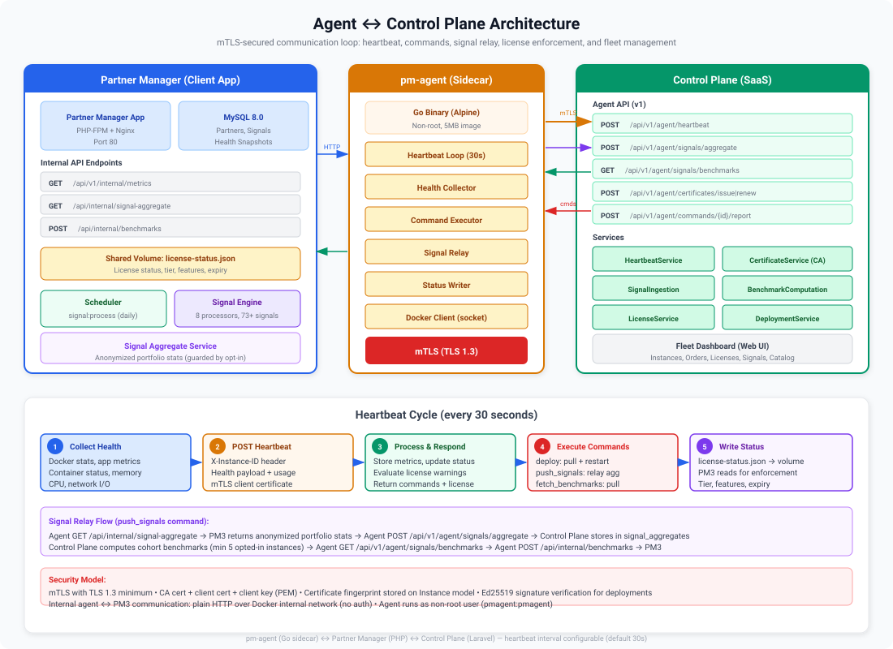

### What the Agent Collects

The agent gathers **operational metadata only** — never business data, user information, or database contents.

| Data Point | Source | Example Value |
|------------|--------|---------------|
| Container names | Docker Engine API | `partner-manager-app-1` |
| Container states | Docker Engine API | `running`, `exited` |
| Container image tags | Docker Engine API | `partner-manager:2.1.0` |
| Container uptime text | Docker Engine API | `Up 3 days` |
| App reachability | Docker Engine API | `true` / `false` |
| Agent process memory | Runtime metrics | `256` (MB) |
| Host OS | System information | `linux` |
| Host architecture | System information | `amd64` |
| Timestamp | System clock | `2026-02-16T10:30:00Z` |

### What the Agent Does NOT Collect

| Data | Why Not |
|------|---------|
| Database contents or schemas | Agent has no database access |
| Database credentials | Stored in app container env, inaccessible to agent |
| Application encryption key (APP_KEY) | Stored in app container env, inaccessible |
| Session secrets or API tokens | Stored in app env or database, inaccessible |
| User accounts, emails, passwords | Stored in database, inaccessible |
| Partner data, plans, engagements | Stored in database, inaccessible |
| Application logs (content) | Not read unless explicitly commanded |
| HTTP traffic or request data | Agent is not a proxy or middleware |
| File contents from app storage | Agent has no app volume access |
| Network traffic between app and DB | Agent has no packet capture capability |

### Heartbeat Payload

Each heartbeat is approximately 400-800 bytes of JSON, amounting to ~3 MB/month per instance:

```json
{
  "instance_id": "inst_abc123",
  "health": {
    "timestamp": "2026-02-16T10:30:00Z",
    "agent_version": "1.2.0",
    "os": "linux",
    "arch": "amd64",
    "app_reachable": true,
    "containers": [
      {
        "name": "partner-manager-app-1",
        "image": "partner-manager:2.1.0",
        "state": "running",
        "status": "Up 3 days"
      }
    ],
    "memory_mb": 256,
    "disk_usage_bytes": 1073741824
  }
}
```

### Supported Commands

The control plane can send commands to the agent via heartbeat responses:

| Command | What It Does | Agent Actions |
|---------|-------------|---------------|
| `deploy` | Deploy a new application version | Verify signature, pull image, restart app container |
| `restart` | Restart a container | Send restart signal to named container |
| `rollback` | Revert to a previous version | Pull previous image tag, restart container |
| `run_migrations` | Execute database schema migrations | Run migration command inside app container |
| `collect_logs` | Gather container logs | Read Docker log output, send to control plane |
| `update_config` | Modify environment variables | Update environment file, restart app |

### Agent Configuration

```yaml
# /etc/pm-agent/config.yaml

instance_id: "inst_abc123"
control_plane_url: "https://fleet.myservice.com"
heartbeat_interval: "30s"

tls:
  ca_cert_path: "/etc/pm-agent/certs/ca.pem"
  client_cert_path: "/etc/pm-agent/certs/client.pem"
  client_key_path: "/etc/pm-agent/certs/client-key.pem"

docker:
  host: "unix:///var/run/docker.sock"
  app_container: "partner-manager-app-1"
```

All configuration files and certificates are mounted **read-only** into the container.

## The Control Plane

The control plane is the centralized management hub for all Partner Manager instances. It is operated by MyService administrators and hosted on MyService infrastructure.

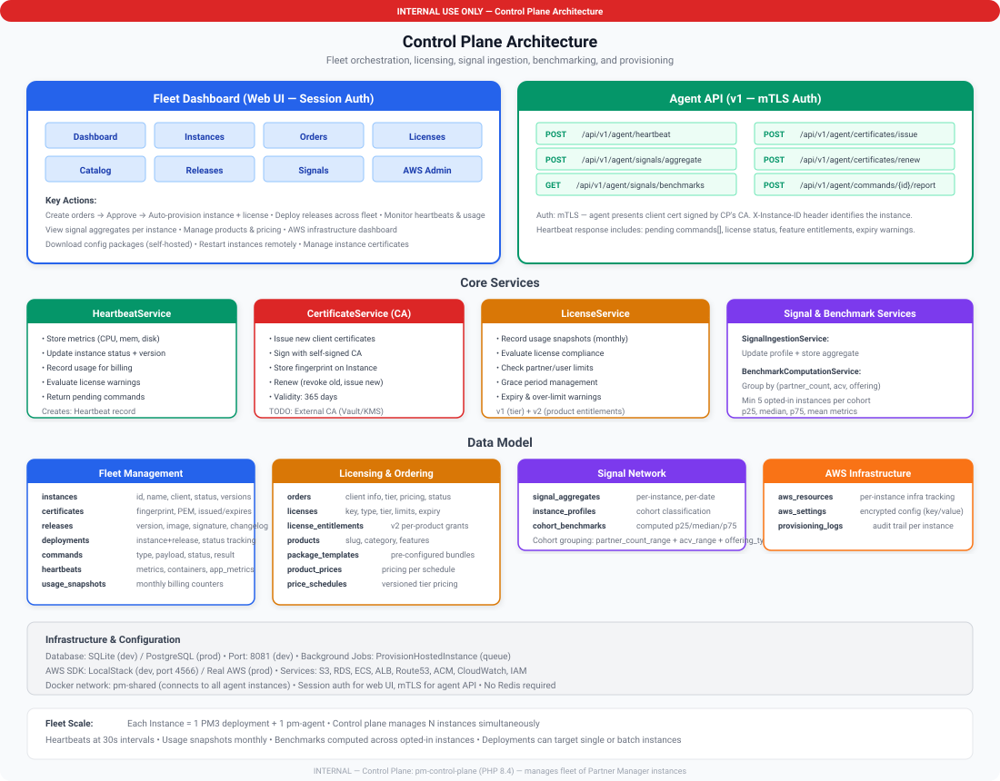

### Capabilities

1. Receives and stores health telemetry from agents
2. Provides a fleet dashboard for operators
3. Manages the release lifecycle (versioning, signing, distribution)
4. Orchestrates deployments and sends commands to agents
5. Issues and manages mTLS client certificates for agents
6. Monitors fleet health and triggers alerts

### What the Control Plane Stores

| Data | Retention | Contains Client Business Data? |
|------|-----------|-------------------------------|
| Instance registry (ID, client name, region, versions, status) | Permanent | No |
| Heartbeat time-series (container states, reachability, metrics) | 30 days (auto-pruned) | No |
| Command audit log (type, payload, result, who issued) | Permanent | No |
| Deployment history (release, instance, status, timing) | Permanent | No |
| Release catalog (version, image tag, signature, changelog) | Permanent | No |
| Certificate records (fingerprint, validity, revocation status) | Permanent | No |

> [!IMPORTANT]
> The control plane stores **only operational metadata**. It never stores, receives, or has access to partner data, user accounts, database credentials, application keys, or any client business information.

### Agent API Endpoints

All agent API routes use mTLS client certificate authentication — no API keys or bearer tokens.

| Method | Endpoint | Purpose |
|--------|----------|---------|
| `POST` | `/api/v1/agent/heartbeat` | Report health, receive pending commands |
| `POST` | `/api/v1/agent/commands/{id}/report` | Report command execution result |
| `POST` | `/api/v1/agent/certificates/issue` | Request a new client certificate |
| `POST` | `/api/v1/agent/certificates/renew` | Renew an expiring certificate |

## Secrets, Credentials, and Key Management

This section documents every secret, credential, and cryptographic key in the system — where it is stored, how it is protected, who can access it, and whether it crosses any boundary.

### Secrets Boundary Map

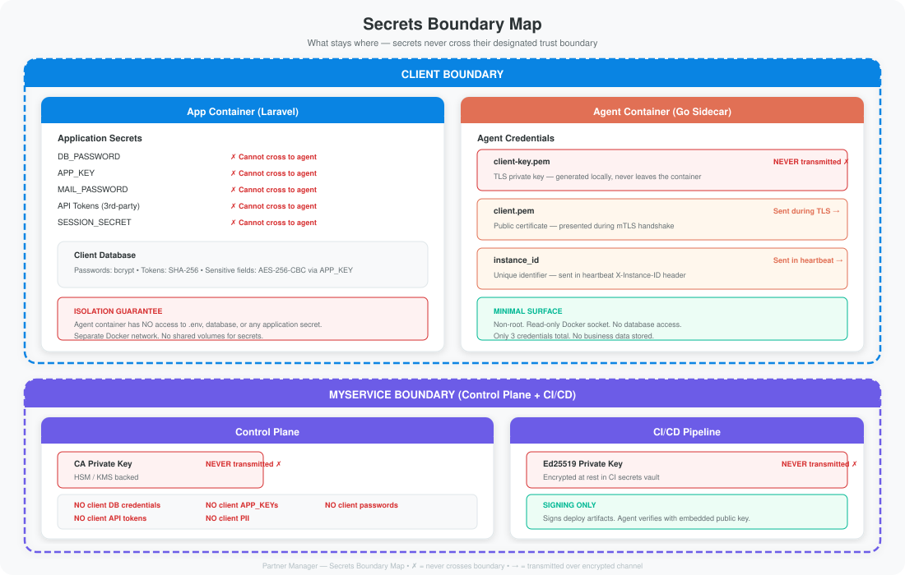

### Database Credentials

| Property | Detail |
|----------|--------|
| **What** | `DB_HOST`, `DB_PORT`, `DB_DATABASE`, `DB_USERNAME`, `DB_PASSWORD` |
| **Where stored** | App container environment variables |
| **Encryption at rest** | Plaintext in Docker environment. Clients should use a secrets manager (Vault, AWS Secrets Manager, Azure Key Vault) for production. |
| **Who can access** | App container process only. The host OS user running Docker can also read container env vars. |
| **Transmitted to agent?** | **Never.** Separate container with no access to app environment. |
| **Transmitted to control plane?** | **Never.** Database credentials never leave client infrastructure. |
| **Rotation** | Client-managed. Update the app container's environment and restart. |

### Application Encryption Key

| Property | Detail |
|----------|--------|
| **What** | `APP_KEY` — a 256-bit AES key used to encrypt session cookies, signed URLs, and any application-layer encrypted data |
| **Where stored** | App container environment variable |
| **Who can access** | App container process only |
| **Transmitted to agent or control plane?** | **Never** |
| **What it protects** | Session integrity, encrypted model attributes, signed URLs, CSRF tokens |
| **Rotation** | Rotating the APP_KEY invalidates all active sessions and data encrypted with the previous key |

### User Passwords

| Property | Detail |
|----------|--------|
| **What** | End-user and portal login passwords |
| **Where stored** | Client database (`users` / `contacts` tables) |
| **Encryption at rest** | **bcrypt** hashed with cost factor 12 (one-way, not reversible). Raw passwords are never stored. |
| **Who can access** | App container (for authentication). Even with direct DB access, only the bcrypt hash is visible. |
| **Transmitted to agent or control plane?** | **Never** |

### API Tokens

| Property | Detail |
|----------|--------|
| **What** | Personal access tokens issued to users or integrations |
| **Where stored** | Client database. The plaintext token is shown once at creation. The stored value is a **SHA-256 hash**. |
| **Encryption at rest** | SHA-256 hashed (one-way). Original token cannot be recovered from the database. |
| **Transmitted to agent or control plane?** | **Never** |
| **Revocation** | Immediate via the application UI |

### Integration Credentials

| Property | Detail |
|----------|--------|
| **What** | OAuth client secrets, webhook signing keys, external API keys (API tokens, CRM integrations) |
| **Where stored** | App container environment variables or encrypted in the client database |
| **Encryption at rest** | Environment: plaintext (recommend secrets manager). Database: encrypted with AES-256-CBC using APP_KEY. |
| **Who can access** | App container process only |
| **Transmitted to agent or control plane?** | **Never** |

### Mail / SMTP Credentials

| Property | Detail |
|----------|--------|
| **What** | `MAIL_HOST`, `MAIL_PORT`, `MAIL_USERNAME`, `MAIL_PASSWORD` |
| **Where stored** | App container environment variables |
| **Who can access** | App container process only |
| **Transmitted to agent or control plane?** | **Never** |

### mTLS Client Certificate and Private Key

| Property | Detail |
|----------|--------|
| **What** | `client.pem` (X.509 certificate) and `client-key.pem` (private key) for agent-to-control-plane authentication |
| **Where stored** | Agent container, mounted read-only at `/etc/pm-agent/certs/` |
| **Encryption at rest** | PEM-encoded files with restrictive permissions (0400). Optionally passphrase-encrypted. |
| **Private key transmitted?** | **Never.** The private key never leaves the agent container. |
| **Public certificate transmitted?** | Yes — presented during the TLS handshake (this is how mTLS works). |
| **Issued by** | Control plane Certificate Authority during instance registration |
| **Validity** | 1 year. Auto-renewed by the agent 30 days before expiry. |
| **Revocation** | Control plane operator can revoke instantly. Agent can no longer authenticate. |

### CA Private Key

| Property | Detail |
|----------|--------|
| **What** | Certificate Authority private key used to sign agent certificates |
| **Where stored** | Control plane infrastructure only. HSM or cloud KMS recommended. |
| **Who can access** | Certificate issuance service only. No routine human access. |
| **Transmitted?** | **Never.** |
| **Compromise impact** | Could issue fraudulent agent certificates. Mitigation: use HSM/KMS, rotate CA key, re-issue all agent certificates. |

### Ed25519 Signing Keys

| Property | Detail |
|----------|--------|
| **What** | Keypair used to sign and verify deployment artifacts (Docker images) |
| **Private key location** | CI/CD pipeline only (encrypted secret). **Never** on control plane, agent, or client infrastructure. |
| **Public key location** | Agent configuration. Not a secret. |
| **Compromise impact** | Could sign malicious images. Mitigation: rotate keypair, push new public key to all agents. |

### Encryption Summary

| Data | At Rest | In Transit | Algorithm |
|------|---------|------------|-----------|
| User passwords | Hashed | N/A (never transmitted) | bcrypt (cost 12) |
| API tokens | Hashed | N/A (never transmitted) | SHA-256 |
| Session data | Encrypted | TLS 1.3 (browser ↔ app only) | AES-256-CBC + HMAC |
| Encrypted model fields | Encrypted | N/A (never transmitted) | AES-256-CBC |
| Agent heartbeat data | Ephemeral | TLS 1.3 (mTLS) | TLS_AES_256_GCM_SHA384 |
| mTLS private key | PEM file | Never transmitted | N/A |
| CA private key | HSM/KMS | Never transmitted | N/A |
| Ed25519 private key | CI/CD secrets | Never transmitted | N/A |
| DB credentials | Plaintext (recommend secrets mgr) | TLS (app ↔ database) | Per-database TLS |

### Recommended Secrets Management

For production deployments, use your cloud provider's secrets management instead of plaintext environment variables:

| Cloud | Service |
|-------|---------|
| **AWS** | AWS Secrets Manager or SSM Parameter Store |
| **Azure** | Azure Key Vault |
| **GCP** | Google Secret Manager |
| **On-premises** | HashiCorp Vault |

## Security Architecture

### Defense in Depth

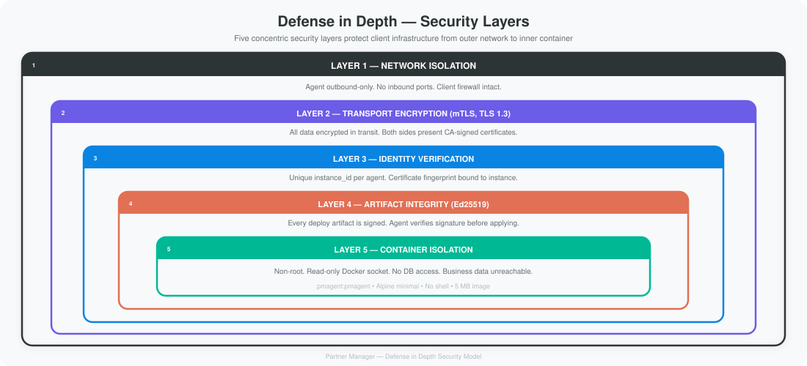

### mTLS (Mutual TLS)

Standard HTTPS verifies the server's identity. mTLS adds client verification — both sides must present a certificate signed by the trusted Certificate Authority.

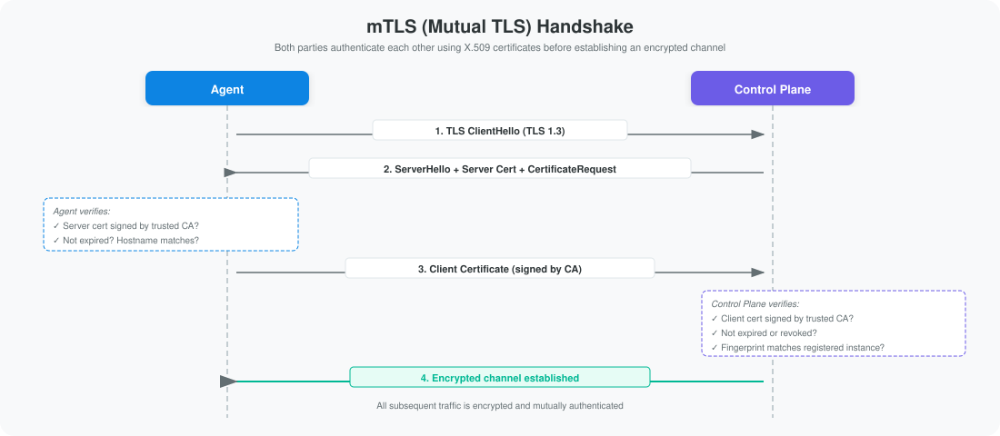

**What this prevents:**
- Unauthorized agents connecting (no valid client cert)
- Agents connecting to a fake control plane (server cert validation)
- Eavesdropping (TLS 1.3 encryption)
- Replay attacks (ephemeral session keys)
- Cross-client impersonation (fingerprint bound to instance_id)

### Ed25519 Artifact Signing

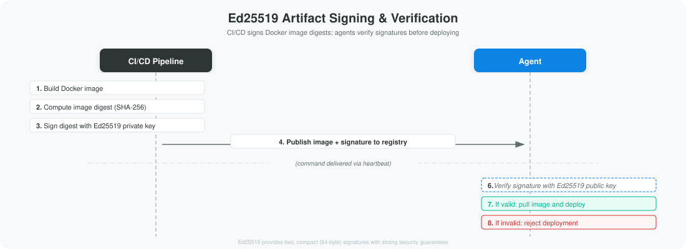

Even if the control plane database is compromised, an attacker cannot forge a valid signature without the Ed25519 private key (held only in CI/CD).

### Threat Model

| Threat | Mitigation |
|--------|-----------|
| Intercept agent traffic | TLS 1.3 encryption on all data in transit |
| Spoof a fake control plane | Agent validates server cert against pinned CA |
| Unauthorized agent connects | mTLS rejects connections without valid client cert |
| Client A impersonates Client B | Certificate fingerprint bound to instance_id |
| Push malicious Docker image | Ed25519 signature verification; unsigned images rejected |
| Read access to control plane DB | Only operational metadata stored — no business data, credentials, or PII |
| Compromise agent container | No DB access, no app volumes, read-only Docker socket, non-root user |
| Control plane goes down | App operates independently; agent retries silently |
| Agent cert compromised | Operator revokes cert; agent cannot authenticate; new cert issued |
| Rogue operator | All commands audit-logged; deployments require signed artifacts |
| Client DB credentials leaked | No impact on control plane or other clients; remediate locally |

## Communication Flows

### Heartbeat Cycle (every 30 seconds)

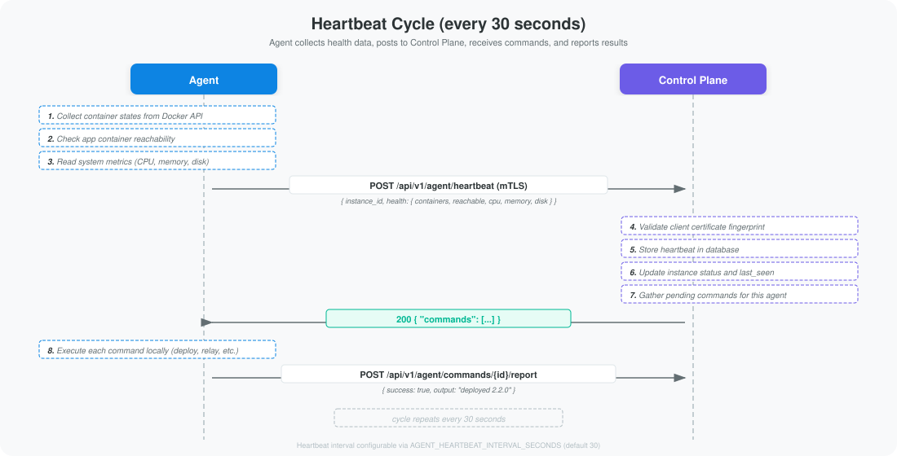

### Deployment Flow

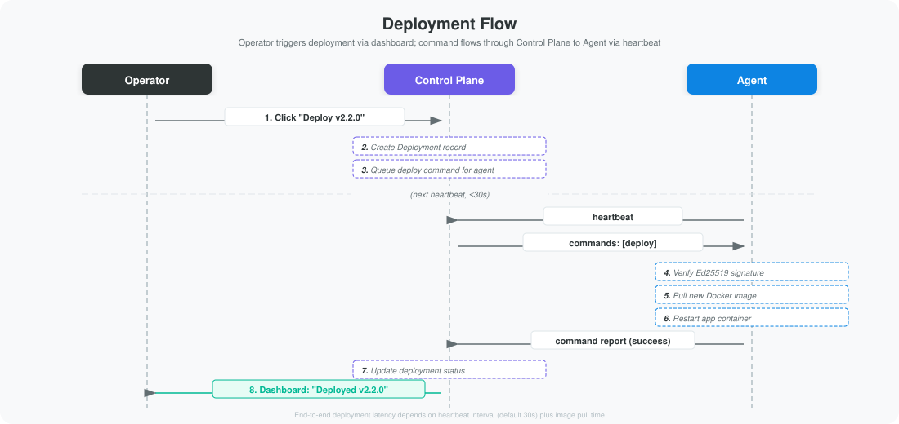

## Data Model

The application data model centers on the **Partner** entity, with related entities for tracking opportunities, certifications, health snapshots, signals, scorecards, and more.

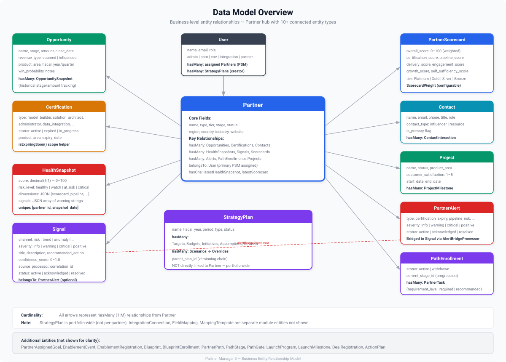

## Scalability

### Application Tier

The application server is **stateless** — all session and cache data is stored in the database. This means:

- **Horizontal scaling** — Add more containers behind the load balancer
- **Zero-downtime deploys** — Roll out new containers while draining old ones
- **Container orchestration** — Compatible with Kubernetes, ECS, or any OCI-compliant orchestrator

### Database Tier

- **Dedicated instance** per client — no shared database, no noisy-neighbor risk
- **Read replicas** can be added for read-heavy analytics workloads
- **Automated backups** — Follow the client's datacenter backup policies

### Caching and Queues

| Component | Backend | Purpose |
|-----------|---------|---------|
| **Cache** | Database (upgradeable to Redis) | Rendered views, computed metrics, config |
| **Sessions** | Database | User session persistence across container restarts |
| **Queues** | Database (upgradeable to Redis) | Background jobs (notifications, imports, reports) |

> [!NOTE]
> The database-backed drivers work well for typical workloads. For high-volume deployments, these can be upgraded to Redis with a configuration change — no code modifications required.

## Resilience and Failure Modes

### What happens when the control plane is unreachable?

| Component | Behavior |
|-----------|----------|
| **Application** | Fully operational. Users experience no disruption. |
| **Agent** | Logs a warning, retries next cycle. No crash, no data loss. |
| **Deployments** | Cannot be initiated until connectivity returns. Running version serves traffic. |

### What happens when the agent crashes?

| Component | Behavior |
|-----------|----------|
| **Application** | Fully operational. The app is unaware the agent exists. |
| **Agent** | Docker restarts it automatically. Heartbeats resume. |
| **Control plane** | Marks instance "stale" after 2 min, "offline" after 5 min. Alerts triggered. |

### What happens when the app container crashes?

| Component | Behavior |
|-----------|----------|
| **Application** | Docker restarts it automatically. |
| **Agent** | Next heartbeat reports `app_reachable: false`. Control plane notified immediately. |
| **Control plane** | Alert triggered. Operator can queue restart command. |

### Status Thresholds

| Time Since Last Heartbeat | Status | Action |
|--------------------------|--------|--------|
| < 2 minutes | **Online** | Normal |
| 2–5 minutes | **Stale** | Warning on dashboard |
| > 5 minutes | **Offline** | Alert logged, notification triggered |

## Single Points of Failure

The architecture is designed so that no single component failure prevents end users from accessing the application. However, certain failures will degrade management capabilities until resolved.

### Analysis

| Component | SPOF For | User Impact if Down | Mitigation |
|-----------|----------|---------------------|------------|
| **Control Plane** | Fleet management, deployments, certificate operations | **None.** All client applications continue serving users normally. Operators lose dashboard visibility and cannot trigger deployments until restored. | Deploy the control plane with high availability (multiple instances behind a load balancer, managed database with automatic failover). |
| **Client Database** | That client's application | **Full outage** for that single client. No other clients affected. | Use managed database services with multi-AZ or automatic failover (RDS Multi-AZ, Azure SQL geo-replication, Cloud SQL HA). Follow the client's disaster recovery policies. |
| **Container Registry** | New deployments only | **None for running instances.** Existing containers continue serving traffic. New deployments cannot pull images until the registry is available. | Use a registry with built-in redundancy (GitHub Container Registry, ECR, ACR). Optionally mirror images to a secondary registry. |
| **CA Infrastructure** | Certificate issuance and renewal | **None for running instances.** Agents with valid certificates continue authenticating normally. New registrations and renewals are blocked until restored. | Use a managed KMS or HSM for the CA key. Certificates have a 1-year validity with 30-day early renewal, providing a large window to restore CA operations. |
| **Agent** | Health monitoring and remote management for that client | **None.** The application is completely independent of the agent. Docker auto-restarts the agent container. The control plane marks the instance as stale/offline and alerts operators. | Docker `restart: unless-stopped` policy auto-recovers crashes. If the agent host fails, the app container on the same host is also affected — this is mitigated by container orchestration (see Scalability). |

### Key Takeaway

The most critical design decision is that **no management-plane failure affects application availability**. The control plane, agent, CA, and registry are all management infrastructure — if any of them go down, users continue working uninterrupted. Only the client's own database is a true availability dependency, and that is fully within the client's control and infrastructure.

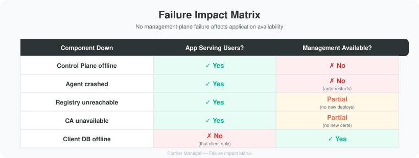

## Docker Compose Reference

```yaml
services:
  app:
    image: ghcr.io/myservice/partner-manager:latest
    restart: unless-stopped
    ports:
      - "80:80"
      - "443:443"
    environment:
      APP_ENV: production
      APP_KEY: "${APP_KEY}"
      DB_CONNECTION: "${DB_CONNECTION:-mysql}"
      DB_HOST: "${DB_HOST}"
      DB_PORT: "${DB_PORT:-3306}"
      DB_DATABASE: "${DB_DATABASE}"
      DB_USERNAME: "${DB_USERNAME}"
      DB_PASSWORD: "${DB_PASSWORD}"
    volumes:
      - app-storage:/var/www/html/storage
      - agent-status:/var/lib/pm-agent/status

  agent:
    image: ghcr.io/myservice/pm-agent:latest
    restart: unless-stopped
    volumes:
      - /var/run/docker.sock:/var/run/docker.sock:ro
      - ./config.yaml:/etc/pm-agent/config.yaml:ro
      - ./certs:/etc/pm-agent/certs:ro
      - agent-status:/var/lib/pm-agent/status
    depends_on:
      - app

volumes:
  app-storage:
  agent-status:
```

### Volume Permissions

| Mount | Container | Access | Contains |
|-------|-----------|--------|----------|
| `app-storage` | App | Read/write | Application storage (logs, cache, uploads) |
| `agent-status` | App | Read/write | Reads version-check info, writes update acceptance |
| `agent-status` | Agent | Read/write | Writes version-check info, reads update acceptance |
| `/var/run/docker.sock` | Agent | **Read-only** | Docker Engine API socket |
| `./config.yaml` | Agent | **Read-only** | Instance ID, control plane URL, interval |
| `./certs/` | Agent | **Read-only** | CA cert, client cert, client private key |
