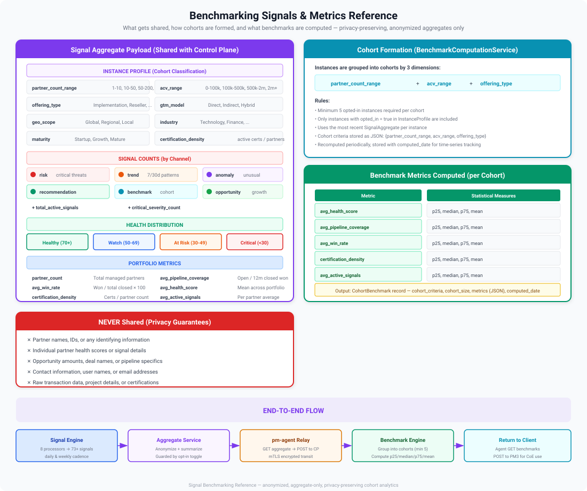

# Benchmarking

Benchmarking allows you to compare a partner's performance against anonymized peer data. This helps identify where a partner excels and where they lag behind similar organizations.

## How It Works

The Benchmark Service computes peer comparisons across key metrics. All comparison data is **anonymized** — partners never see the identities of their peers.

## Benchmark Dimensions

| Dimension | What's Compared |
|-----------|----------------|
| **Revenue** | Pipeline value, win rate, deal size relative to peers |
| **Delivery** | Project success rate, resource utilization |
| **Enablement** | Certification count, training completion rate |
| **Engagement** | Event participation, QBR frequency |

## Viewing Benchmarks

Navigate to **Measure > Benchmarking** to see how a selected partner compares.

<!--  -->

The benchmark view shows:

- Partner's position relative to the peer median
- Percentile ranking per dimension
- Areas of strength and areas for improvement

## Peer Groups

Partners are compared against peers at the same tier or path stage. This ensures fair comparisons — a newly onboarded partner is not compared against a strategic partner.

> [!TIP]
> Benchmarking data is powerful in QBR conversations. Showing a partner that they are in the top quartile for certifications but bottom quartile for pipeline contribution creates a clear, data-driven discussion.

> [!NOTE]
> Benchmark data updates as snapshots are captured. The comparison reflects the most recent snapshot cycle.
