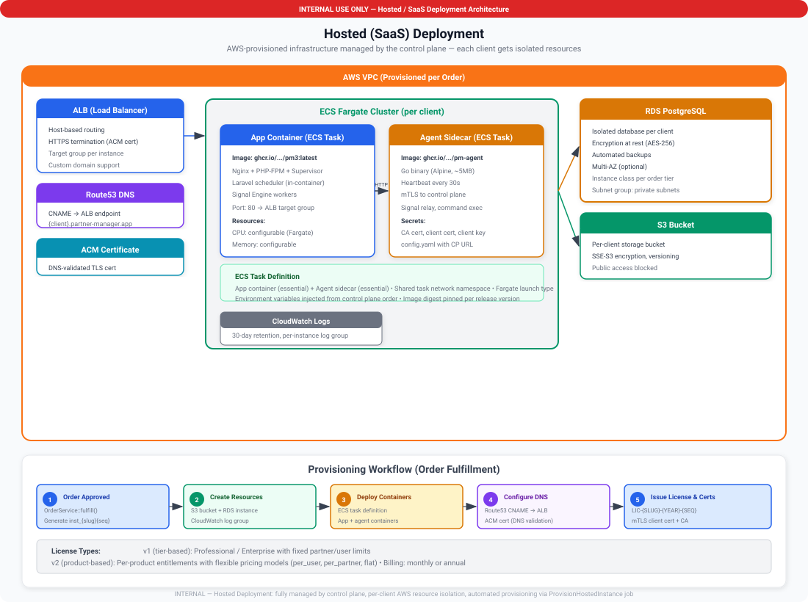

# Deployment Options

Partner Manager supports two deployment models. Both deliver the same application with the same features — the difference is who operates the infrastructure.

## Self-Hosted

The client provisions and manages their own infrastructure. Partner Manager runs as Docker containers in the client's datacenter, VPC, or cloud account.

**How it works:**

- Client provides compute (VM or bare metal), a [supported database](database-support), and outbound HTTPS access
- We provide the Docker images, configuration, and TLS certificates
- The PM Agent sidecar handles automatic updates, health monitoring, and license validation
- The control plane monitors all instances remotely via the agent heartbeat

**Responsibilities:**

| Area | Client | Us |
|------|:------:|:--:|
| Compute provisioning | Yes | — |
| Database hosting | Yes | — |
| Network / firewall | Yes | — |
| OS patching | Yes | — |
| Application updates | — | Yes (via agent) |
| Monitoring & alerting | — | Yes (via control plane) |
| License management | — | Yes |
| Support | — | Yes |

**Pricing:** License fee only. See [Licensing](licensing) for tiers and rates.

| Tier | Monthly | Annual |
|------|--------:|-------:|
| Starter | $349/mo | $3,490/yr |
| Growth | $599/mo | $5,990/yr |
| Professional | $999/mo | $9,990/yr |
| Enterprise | Custom | Custom |

**Best for:** Clients with strict data residency requirements, existing infrastructure teams, or regulatory constraints that mandate on-premise hosting.

## Managed Service

We provision and operate the infrastructure on behalf of the client. The application runs in our cloud environment with dedicated, isolated resources per client.

**How it works:**

- We provision a dedicated environment (compute, database, networking) for each client
- Infrastructure is fully managed — patching, backups, scaling, and monitoring
- The client accesses Partner Manager through a dedicated URL
- Same agent-based management, same control plane visibility

### Isolation & Access Boundaries

Although we provision and maintain the infrastructure, **only the client has access to what runs inside their containers**. Each managed deployment consists of three dedicated containers — the application, the sidecar agent, and the database — and these containers are fully isolated from every other client and from our own operations staff.

**What the client controls:**

| Resource | Client Access |
|----------|--------------|
| Application data | Full access — all partner, user, and configuration data lives exclusively in the client's database container |
| Database | Only the client's application container can connect — credentials are generated at provisioning time and are never stored or accessible outside the client's environment |
| Application key (`APP_KEY`) | Generated inside the client's container at provisioning — used to encrypt session data and sensitive fields, never transmitted or stored externally |
| User credentials | Managed entirely within the client's application — passwords, API tokens, and session data never leave the container |
| File uploads & storage | Stored in the client's application container volume — not accessible to any other container or client |

**What we (the hosting provider) can access:**

| Resource | Our Access | Purpose |
|----------|-----------|---------|
| Container health status | Running, stopped, or crashed | Restart unhealthy containers, maintain uptime SLA |
| Resource utilization | CPU, memory, and disk usage metrics | Capacity planning and scaling |
| Agent heartbeat data | Instance ID, application version, container state | Fleet dashboard monitoring and update orchestration |
| Container image versions | Which version of the application and agent images are running | Coordinate version deployments |
| Network routing | Inbound traffic routing to the client's container | TLS termination and DNS management |
| Backup snapshots | Encrypted, opaque database snapshots | Disaster recovery (we cannot read the contents) |

**What we cannot access:**

- The client's database contents — we have no credentials and no network path into the database container
- Application data, partner records, user information, or any business data
- The application encryption key (`APP_KEY`) or any user passwords
- File uploads, session data, or API tokens
- The application's internal configuration or environment variables

> [!NOTE]
> Database backups are performed at the storage layer using encrypted snapshots. The snapshots are opaque to our operations team — they can restore a snapshot to the client's container in a disaster recovery scenario, but they cannot mount, read, or query the contents independently.

**Responsibilities:**

| Area | Client | Us |
|------|:------:|:--:|
| Compute provisioning | — | Yes |
| Database hosting | — | Yes |
| Network / firewall | — | Yes |
| OS patching | — | Yes |
| Application updates | — | Yes |
| Monitoring & alerting | — | Yes |
| Backups | — | Yes |
| License management | — | Yes |
| Support | — | Yes |

**Pricing:** License fee + infrastructure fee. The infrastructure fee covers compute, database, networking, backups, and operations.

| Tier | License | Infra Fee | Total Monthly | Total Annual |
|------|--------:|----------:|--------------:|-------------:|
| Starter | $349/mo | +$199/mo | $548/mo | $5,480/yr |
| Growth | $599/mo | +$349/mo | $948/mo | $9,480/yr |
| Professional | $999/mo | +$499/mo | $1,498/mo | $14,980/yr |
| Enterprise | Custom | +$499/mo | Custom | Custom |

Annual pricing includes the same ~17% discount on the license portion. Infrastructure fees are fixed.

**Best for:** Clients who want zero operational overhead, fast onboarding, or do not have internal infrastructure teams.

## Comparison

| | Self-Hosted | Managed Service |
|---|:-----------:|:---------------:|
| **Data location** | Client-controlled | Our cloud (region selectable) |
| **Data access** | Client-only | Client-only (we cannot access container contents) |
| **Setup time** | 1-2 days (with client infra ready) | Same day |
| **Operational burden** | Client manages compute & DB | Fully managed |
| **Pricing** | License only | License + infrastructure fee |
| **SLA** | Depends on client infra | 99.9% uptime guarantee |
| **Customization** | Full control over environment | Standard environment |
| **Compliance** | Client controls all data | SOC 2, GDPR compliant |

## How to Choose

- **Choose Self-Hosted** if you need full control over where data lives, have existing infrastructure and ops teams, or have regulatory requirements for on-premise hosting.
- **Choose Managed Service** if you want to get started quickly, prefer not to manage infrastructure, or want a guaranteed SLA without operational overhead.

Both options include the same application features, the same agent-based management, and the same support tiers. You can also migrate between deployment models if your needs change.

## Further Reading

- [Deployment](deployment) — Step-by-step self-hosted deployment guide
- [Architecture](architecture) — System architecture and component overview
- [Licensing](licensing) — License types, pricing, and billing options
