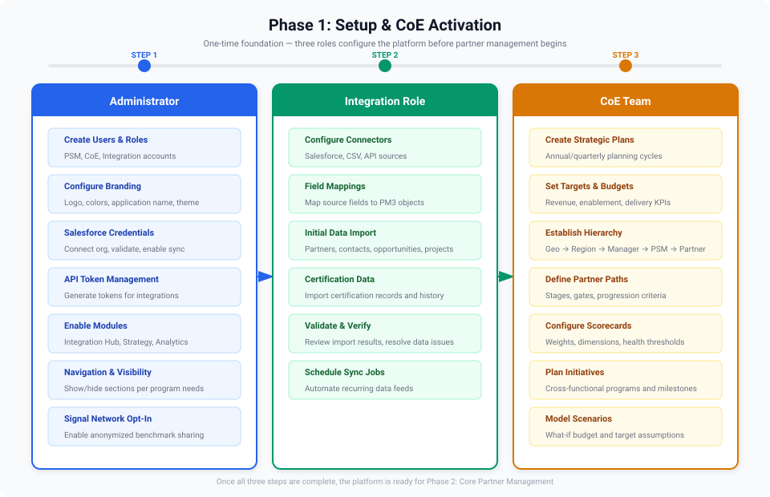
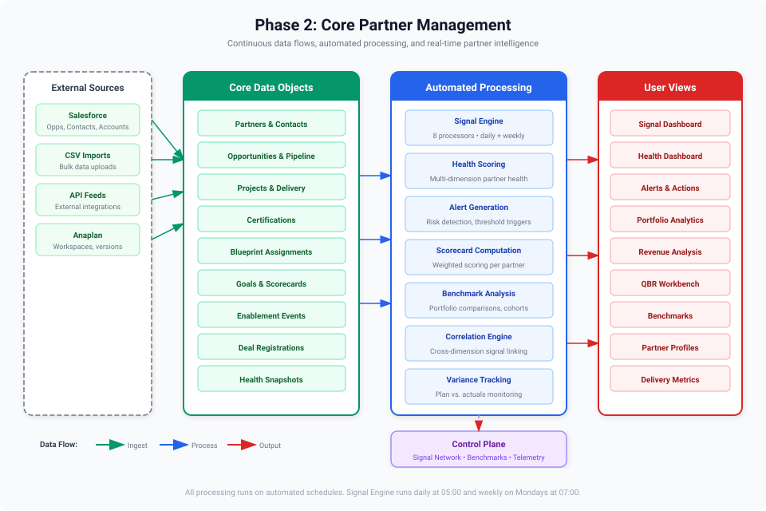
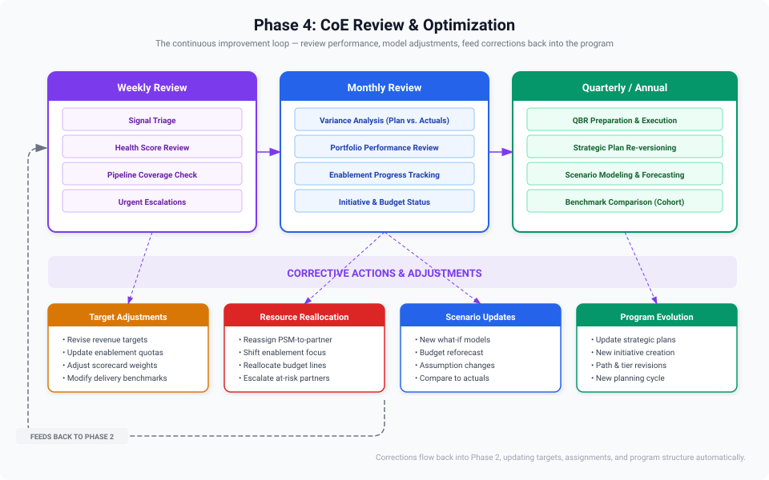
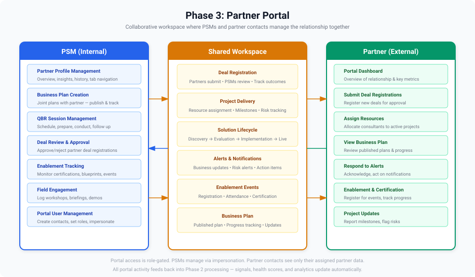

# Getting Started

This guide walks each user type through their first steps with Partner Manager. Administrators need to complete one-time setup before PSMs and partners can use the platform effectively.

## Administrator: Initial Setup

After a fresh deployment, the administrator must configure several foundational elements before the platform becomes useful. Complete these steps in order.

### 1. Branding & Configuration

Start by establishing your organization's identity and preferences:

1. Navigate to **System Administration > Branding**
2. Set the application name (e.g. "Acme Partner Hub")
3. Upload your organization's logo and favicon
4. Select a default color theme or configure custom brand colors
5. Navigate to **System Administration > Configuration**
6. Adjust scorecard weights to reflect your organization's priorities
7. Configure alert thresholds for health scores, overdue tasks, and expiring certifications

See [Branding](branding) and [Configuration](configuration) for details.

### 2. Define Partner Paths

Paths are the backbone of prescriptive partner management. Each path defines the stages a partner progresses through, the gates they must pass, and the tasks that are auto-generated at each stage.

1. Navigate to **Partner Administration > Partner Paths > Path Configuration**
2. Create your first path (e.g. "Standard Partner Maturity")
3. Define stages such as Onboarded, Enabled, Performing, Accelerating, Strategic
4. Set gate criteria for each stage transition (e.g. certifications, revenue targets, delivery metrics)
5. Create task templates for each stage — these auto-populate when a partner is enrolled

> [!WARNING]
> At least one path must exist before partners can be enrolled. Without paths, partners cannot receive auto-generated tasks or progress through stages. Take time to define meaningful stages and gates that reflect your actual partner maturity model.

See [Partner Paths](partner-paths) for the full guide.

### 3. Create Users & Assign Roles

Add the PSMs and managers who will use the platform:

1. Navigate to **System Administration > User Management**
2. Create user accounts for each PSM and manager
3. Assign the appropriate role — **Admin**, **PSM**, or **Manager**

See [User Management](user-management) and [Roles & Permissions](roles-and-permissions) for details.

### 4. Import Data

Populate the platform with your existing partner data. Partner Manager supports bulk imports for several data types:

1. Navigate to **System Administration > Data Imports**
2. Import **partners** — creates partner records with basic profile data
3. Import **PSM assignments** — maps partners to their assigned PSMs
4. Import **opportunities** — populates the pipeline and revenue data
5. Import **accounts** — links Anaplan workspace accounts to partner records
6. Import **resources** — adds partner resource and certification data

> [!TIP]
> Download the import templates from the Data Imports page to see the expected file format for each type. Use XLSX files for best results.

### 5. Enroll Partners in Paths

Once partners and paths exist, enroll partners to begin their maturity journey:

1. Navigate to a partner's profile
2. Enroll them in the appropriate path
3. The system auto-generates stage tasks from your templates

### 6. Set Up Enablement Content

Create the learning and enablement resources your partners will use:

1. **Blueprints** — Navigate to **Partner Administration > Enablement > Blueprints** and create structured learning paths with outcomes and content items
2. **Enablement Events** — Navigate to **Partner Administration > Enablement > Enablement Events** and create events with sessions, registration tracking, and calendar scheduling
3. **Launch Programs** — Navigate to **Partner Administration > Launch Programs** and set up product launch programs with milestones and partner nominations

See [Blueprints Admin](blueprints-admin), [Enablement Calendar](enablement-calendar), and [Launch Programs](launch-programs) for details.

### 7. Configure Goals & Scorecards

Establish performance targets for the current fiscal year:

1. Navigate to **Partner Administration > Goals > Templates** and create goal templates
2. Set targets for sourced revenue, certifications, delivery quality, and engagement
3. Assign goals to individual partners or apply templates across tiers

See [Goals & Targets](goals-and-targets) and [Scorecard](scorecard) for details.

### 8. Provision Partner Portal Access

Enable self-service access for partner contacts:

1. Navigate to **Partner Administration > Provisioning**
2. Set up workspaces for partners that need portal access
3. Invite partner contacts with appropriate portal roles

See [Portal Overview](portal-overview) and [Provisioning](provisioning) for details.

---

## PSM: Day-One Onboarding

Once an administrator has completed the initial setup and assigned you to partners, here's how to get started as a Partner Success Manager.

### Logging In

Navigate to the Partner Manager URL provided by your administrator and log in with your credentials.

### The Dashboard

After logging in, your dashboard provides an at-a-glance view of your portfolio:

- **Partner count** and tier distribution
- **Active tasks** requiring your attention
- **Upcoming events** and deadlines
- **Health alerts** for at-risk partners

### Navigation

Partner Manager uses a left-hand sidebar organized by four pillars:

| Pillar | What You'll Find |
|--------|-----------------|
| **Plan** | Partner paths, task boards, action plans, goals, scorecards, competency matrices |
| **Engage** | Project health, field enablement, deal registration, solution lifecycle, QBRs, events, blueprints |
| **Measure** | Portfolio analytics, delivery metrics, revenue analysis, benchmarking |
| **Act** | Health dashboard, alerts, path reviews |

### Your First Steps

1. **Review your assigned partners** — Navigate to your partner list and familiarize yourself with each partner's current stage, scorecard, and open tasks
2. **Check your task board** — Go to **Plan > Task Board** to see tasks awaiting action. Address any overdue items first
3. **Review health alerts** — Go to **Act > Health Dashboard** to see any partners flagged as at-risk
4. **Schedule QBRs** — For partners that are due, start building QBR sessions under **Engage > QBR Workbench**
5. **Assign blueprints** — Review available blueprints and assign relevant ones to partners that need enablement
6. **Register partners for events** — Check the **Engage > Enablement Events** calendar and register partners for upcoming sessions

### Ongoing Workflow

As a PSM, your daily workflow typically follows this cycle, feeding into continuous optimization.

1. **Plan** — Review tasks, update action plans, set goals for the quarter
2. **Engage** — Conduct enablement, manage deal registrations, hold QBR sessions
3. **Measure** — Monitor scorecards, track delivery metrics, analyze revenue trends
4. **Act** — Respond to health alerts, conduct path reviews, advance partners through stages

---

## Partner: Getting Started with the Portal

As a partner contact, you access Partner Manager through the **Partner Portal** — a self-service interface for tracking your organization's progress, registering for events, and managing deal registrations.

### Accessing the Portal

1. You will receive an invitation email from your Partner Success Manager or the system
2. Follow the link to set up your portal credentials
3. Log in at the Partner Portal URL (separate from the PSM application)

> [!NOTE]
> Portal credentials are separate from the PSM application. If you are unsure of your login URL, contact your Partner Success Manager.

### What You Can Do

Depending on your portal role, you may have access to:

- **Scorecard** — View your organization's performance metrics and progress
- **Goals** — Track your targets for the current fiscal year
- **Blueprints** — Access learning paths and track your progress through assigned content
- **Events** — Browse and register for upcoming enablement sessions
- **Deal Registration** — Submit new deals for approval and track existing registrations
- **Team** — View and manage your organization's portal contacts (if you have team management access)

See [Portal Overview](portal-overview) and [Portal Roles](portal-roles) for the full list of capabilities by role.

---

## Next Steps

| If you are... | Start here |
|---------------|------------|
| An **Admin** setting up for the first time | [Configuration](configuration), [Partner Paths](partner-paths) |
| A **PSM** managing partners | [Task Board](task-board), [Scorecard](scorecard), [Action Plans](action-plans) |
| A **Partner** using the portal | [Portal Overview](portal-overview), [Blueprints](blueprints) |
