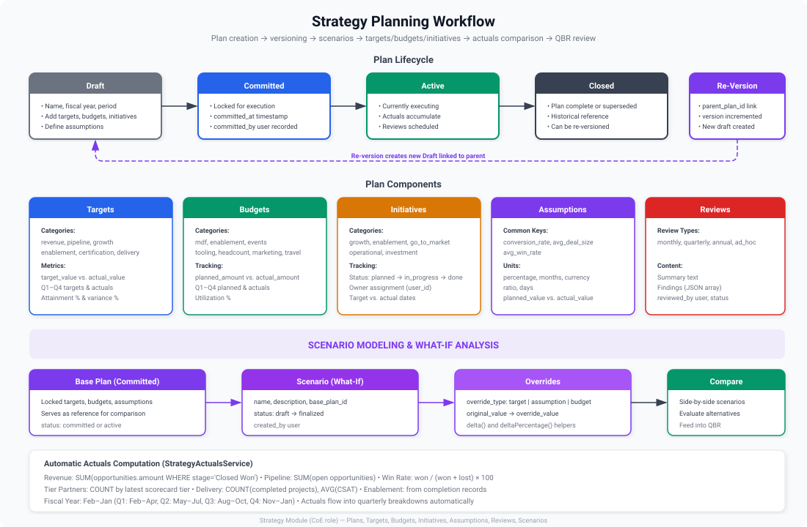

# Goals & Targets

Goals define what a partner should achieve within a fiscal year. They provide measurable targets that feed into the partner scorecard and health score.

## Goal Categories

Goals can be set across multiple dimensions:

- **Revenue** — Sourced and influenced pipeline targets
- **Certifications** — Number of certified practitioners
- **Delivery** — Project completion and quality metrics
- **Enablement** — Training completion and event participation

## Setting Goals

1. Navigate to the partner's profile
2. Go to **Plan > Goals**
3. Click **New Goal** or use a goal template
4. Set the fiscal year, target value, and category
5. Click **Save**

<!--  -->

## Goal Templates

Admins can create goal templates that pre-define standard targets based on partner tier or path stage. When applied, a template automatically creates the configured set of goals for a partner.

> [!NOTE]
> Goal templates are managed under **Administration > Goal Templates**. They can be applied individually or in bulk across a partner portfolio.

## Tracking Progress

Goal progress is computed automatically from the underlying data:

- Revenue goals track against the opportunity pipeline
- Certification goals count verified certifications
- Delivery goals measure project completion rates

The progress percentage is displayed on the partner profile and feeds into the scorecard calculation.

## Fiscal Year Alignment

Goals are tied to a fiscal year. When a new fiscal year begins, previous goals are archived and new goals can be created from templates or manually.
