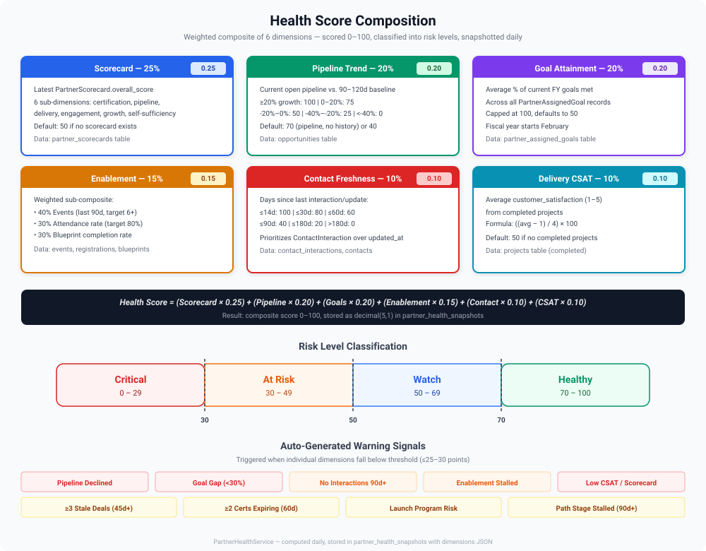

# Health Dashboard

> [!NOTE]
> Available to: PSM, Manager, Administrator

The Health Dashboard provides a risk-oriented view of your partner portfolio. It surfaces partners that need attention based on computed health scores and automated alerts.

## Health Score

Each partner has a health score computed from multiple weighted dimensions.

The contributing dimensions are:

- **Scorecard performance** — Are they meeting their metric targets?
- **Delivery quality** — Are their projects on track?
- **Engagement level** — Are they participating in events and QBRs?
- **Certification progress** — Are they building capability?
- **Pipeline activity** — Is their opportunity pipeline growing or shrinking?

The health score is categorized as:

| Status | Meaning |
|--------|---------|
| **Healthy** | Partner is on track across most dimensions |
| **At Risk** | One or more dimensions are declining |
| **Critical** | Multiple dimensions are below threshold |

## Dashboard View

Navigate to **Act > Health Dashboard** to see the health status of your portfolio.

<!--  -->

The dashboard shows:

- Distribution of partners by health status
- List of at-risk and critical partners with the contributing factors
- Health trend over time (improving, stable, declining)
- Quick actions for each flagged partner

## Health Snapshots

Health scores are captured as snapshots at regular intervals. This creates a historical record that enables:

- Trend analysis across quarters
- Identification of partners whose health is deteriorating
- Measurement of intervention effectiveness

> [!TIP]
> Check the health dashboard at the start of each week to prioritize which partners need immediate attention.
