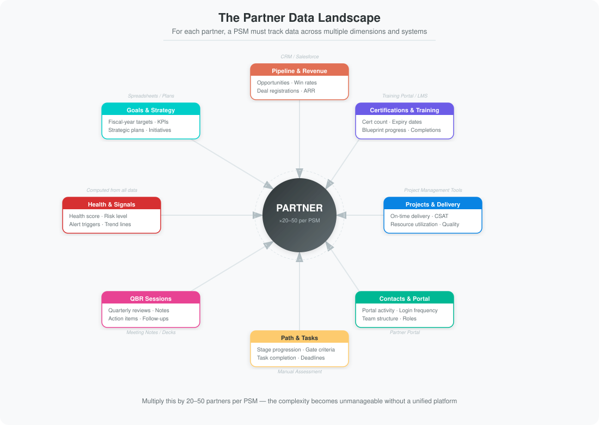
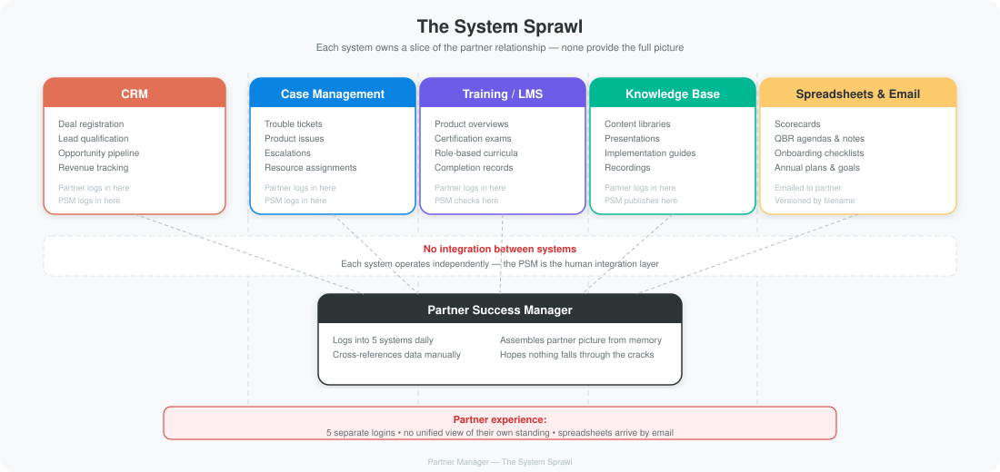
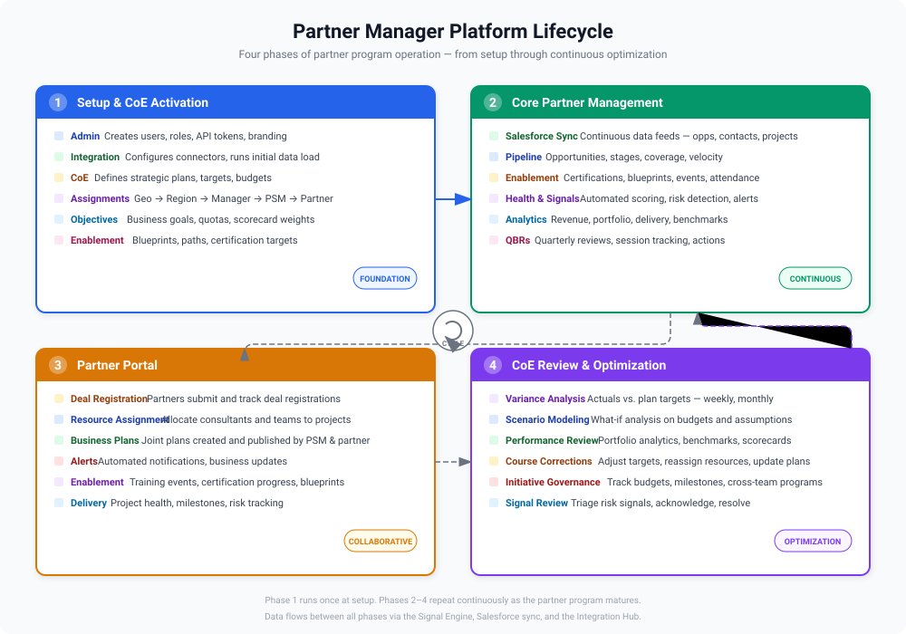
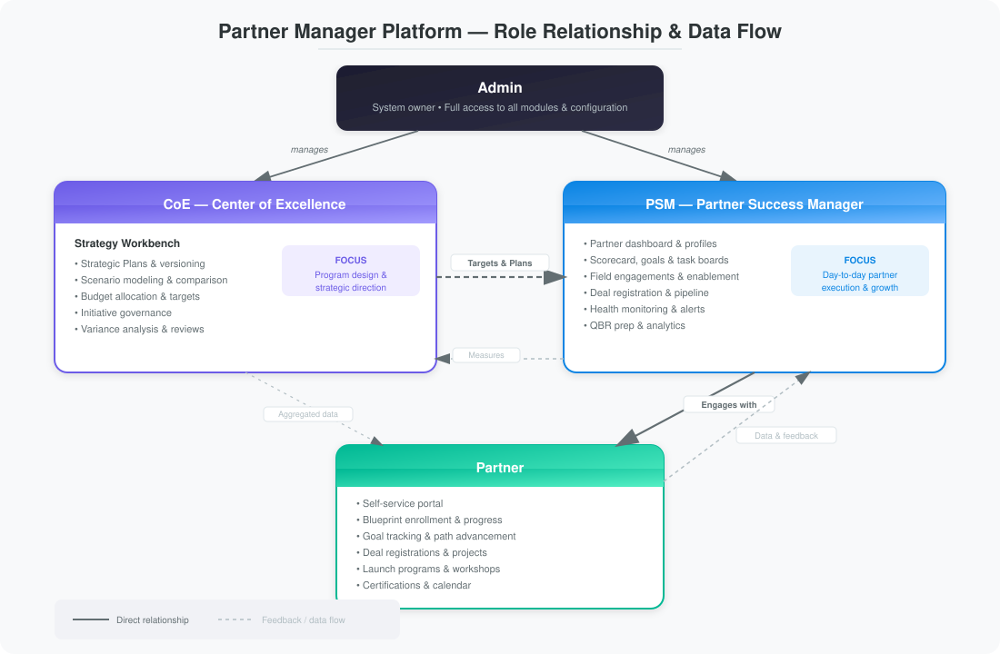

# Overview

## Why Partner Ecosystems Exist

Enterprise software doesn't sell itself, and it certainly doesn't implement itself. The more powerful and configurable a platform becomes, the wider the gap grows between what the software *can* do and what a customer can figure out on their own. Bridging that gap requires deep domain expertise, implementation methodology, and hands-on delivery capacity — things that are extraordinarily difficult and expensive to build in-house at global scale.

This is why modern software companies invest in partner ecosystems. Instead of hiring thousands of consultants across every geography, industry, and use case, they cultivate a network of independent firms that specialize in delivering the product. Partners bring local market knowledge, vertical expertise, existing customer relationships, and the ability to scale capacity in ways an internal team never could.

The math is compelling. A well-functioning partner ecosystem multiplies your reach without multiplying your headcount. Partners source pipeline you would never have found, deliver implementations you could never have staffed, and create customer stickiness that no renewal campaign can match.

But ecosystems don't manage themselves.

## The Management Burden

As a partner ecosystem grows, the organization typically stands up a dedicated team — a Partner Center of Excellence — to run it. The CoE is responsible for the strategy and operational framework that governs the entire ecosystem: defining partner tiers and maturity models, designing onboarding and ramping programs, setting certification requirements and enablement curricula, establishing performance benchmarks and success metrics, allocating co-marketing and co-selling resources, and running quarterly business review cadences. In short, the CoE designs the playbook. It defines what a "good partner" looks like at each stage of maturity and what it takes to get there.

The PSMs then execute that playbook. A single PSM typically owns a portfolio of 20 to 50 partners, and for *each* of those partners, they need to track:

- **Pipeline and revenue** — Are they sourcing deals? What's their win rate? Is their pipeline growing or shrinking?
- **Certifications and training** — Do they have enough certified consultants? Are certifications expiring? Are they completing the enablement blueprints the CoE designed?
- **Project delivery** — Are their implementations on time? What does customer satisfaction look like?
- **Engagement** — Are they showing up to QBRs? Attending events? Registering deals?
- **Health signals** — Is this partner trending up or quietly disengaging?
- **Goals and strategy** — What did we agree to last quarter? Are we on track against the objectives the CoE set?

Multiply those dimensions by 30 partners, and you get hundreds of data points that change weekly. No human can track that in their head.

The typical response is linear: five new partners means one new hire. Ten more means another. The investment isn't just PSM headcount — it's the entire CoE apparatus: enablement programs, certification infrastructure, QBR cycles, co-marketing budgets, ramping curricula, and executive sponsor time. The cost of supporting a partner network compounds quickly, and the uncomfortable truth is that most organizations have no rigorous way to measure the return on that investment. They know what they're spending. They rarely know what they're getting back, partner by partner.

## The System Sprawl

Over time, partner programs accumulate a collection of disconnected but individually important systems — each solving one piece of the puzzle, none providing the full picture.

**CRM** handles deal registration, lead qualification, and opportunity management. It's the system of record for pipeline, but it knows nothing about a partner's certification status, project delivery quality, or maturity stage.

**Case management** tracks trouble tickets, product issues, and configuration challenges. It captures escalations and resource assignments, but that data lives in its own silo — a partner with a pattern of recurring support issues looks fine in the CRM if their pipeline numbers are healthy.

**Training and certification platforms** deliver product overviews, role-based curricula, and certification exams. They can tell you who passed what, but they can't connect certification gaps to delivery quality or pipeline readiness.

**Knowledge management systems** house content libraries, presentations, recordings, implementation guides, and best practices. They're repositories, not workflows — content gets published, but there's no way to know whether partners are actually consuming what they need at each stage of their maturity.

**Spreadsheets and email** fill every remaining gap. Scorecard calculations, QBR agendas, annual plans, onboarding checklists, tier qualification matrices — all maintained manually, versioned by filename, and distributed as attachments.

And the landscape never sits still. Software vendors ship continuously — new features, new applications, new use cases, new versions. Every release creates a ripple across the ecosystem: updated training materials, revised certification requirements, new implementation methodologies, changed best practices. The partner who was fully enabled six months ago may now be working from outdated knowledge. But there's no systematic way to know which partners have absorbed the latest changes and which are falling behind — because the training platform, the knowledge base, and the certification system don't talk to the maturity model or the PSM's scorecard. Currency is invisible until it surfaces as a delivery problem.

And from the partner's perspective, the experience is fragmented. They log into the CRM for deal registration, a different system for training, another for support cases, another for content, and they receive spreadsheets by email for everything else. There is no single place where a partner can see their own standing, understand what's expected of them, or track their progress. The ecosystem that's supposed to enable them instead presents a maze of disconnected portals.

## How Teams Cope Today

Faced with this system sprawl, PSMs become the human integration layer. They are the ones who log into five systems, cross-reference data manually, and try to assemble a coherent picture of each partner's health.

**Manual aggregation before every review** — When a QBR approaches, the PSM spends hours pulling data from CRM, the training platform, case management, and their own spreadsheets to assemble a current picture of the partner. By the time the deck is built, half the data is already stale. The meeting that should be a strategic conversation becomes a data validation exercise. When the CoE needs a portfolio-level view for executive reporting, the problem compounds — they're aggregating aggregations.

**No early warning system** — When a partner begins to disengage — fewer deal registrations, expiring certifications, rising support escalations, declining project quality — the signals appear in different systems at different times. By the time a PSM notices the pattern, the partner may have already lost momentum. There is no unified view that connects these signals and raises a flag before it's too late.

**No repeatable playbook** — The CoE may define a maturity model and a set of programs, but without a system to enforce them, execution is inconsistent. Every PSM interprets the framework differently. One might be rigorous about quarterly planning; another might focus on certification tracking; a third might be great at relationship-building but terrible at data hygiene. Without a shared operational system, partner outcomes depend on which PSM they're assigned to — not on the quality of the CoE's programs.

**No way to measure what's working** — Leadership can see total partner-sourced revenue, but they can't see *why* some partners thrive while others stall. Was it the enablement program? The PSM's effort? Market conditions? The CoE invests in programs and initiatives but has no closed-loop system to measure their impact. Without a way to connect investment to outcomes at the individual partner level, resource allocation is driven by gut feel and headcount ratios rather than data.

The result: the best PSMs succeed *despite* their tools, not *because* of them. And neither the CoE nor the organization has a consistent, scalable way to ensure that every partner gets the same quality of management — or to prove that the investment in the ecosystem is paying off.

## The Insight

Partner management isn't a reporting problem. Organizations don't lack data — they drown in it, scattered across a dozen systems that each tell one part of the story. What's missing isn't another dashboard or a better spreadsheet. What's missing is a *process* — one that connects the CoE's strategy to the PSM's daily execution to the partner's measurable outcomes.

The fundamental question isn't "What happened with this partner last quarter?" It's **"What should I do with this partner next?"**

That distinction — between *descriptive* and *prescriptive* — is the key insight. Descriptive tools tell you what happened. Prescriptive tools tell you what to do. One creates more reading. The other creates action.

## Partner Manager

Partner Manager is a prescriptive partner management platform. It consolidates every dimension of the partner relationship into a single system, and then does something most tools don't: it tells you what to do next.

The CoE defines the framework: partner paths with stages and gates, scorecard weights and benchmarks, task templates and enablement milestones, certification requirements and ramping programs. These become the operating system for the entire ecosystem — not a strategy deck that sits in a shared drive, but a live system that every PSM executes against every day.

Every partner follows a defined path with clear stages, measurable gates, and automatically generated tasks. Health scores surface risk before it becomes a crisis. Scorecards replace spreadsheets with live, weighted metrics. QBR preparation becomes one click instead of a half-day exercise.

Partners get a single portal — one place to see their standing, track their progress, register deals, and understand what's expected of them next. No more navigating five disconnected systems to piece together their own status.

The platform is organized around four pillars that map to the continuous management cycle:

| Pillar | Purpose |
|--------|---------|
| **Plan** | Define paths, set goals, assign tasks, and establish competency targets |
| **Engage** | Execute on enablement, deal registration, QBRs, and project oversight |
| **Measure** | Track health scores, delivery metrics, revenue, and benchmarks |
| **Act** | Respond to alerts, conduct path reviews, and drive the next action |

Because every interaction is structured and tracked, the platform also answers the ROI question that spreadsheets never could: which partners are progressing, which are stalling, where is investment producing returns, and where should resources be redirected. The CoE gets closed-loop visibility into which programs are working. Leadership gets evidence, not anecdotes. Partner management shifts from intuition to system.

## Key Capabilities

### Partner Paths

Partners progress through gate-based stages — from **Onboarded** to **Strategic**. Each stage has defined requirements that must be met before advancement. PSMs manage the review and approval process.

### Scorecard & Goals

Every partner has a quantitative scorecard driven by weighted metrics. Goals are set at the fiscal-year level for sourced revenue, certifications, and delivery quality.

### Task Board

Prescriptive tasks are generated automatically based on a partner's current stage and path. PSMs can also create ad-hoc tasks with ownership and deadlines.

### Partner Portal

Partners have self-service access to view their scorecard, register for events, submit deal registrations, and track their progress through learning blueprints.

> [!NOTE]
> Portal access is role-based. Different portal roles see different capabilities. See the [Portal Roles](portal-roles) page for details.

## Getting Help

If you are new to Partner Manager, start with the [Getting Started](getting-started) guide, which covers:

- **Administrators** — One-time setup checklist (paths, users, imports, branding)
- **PSMs** — Day-one onboarding and daily workflow
- **Partners** — Portal access and self-service capabilities

> [!TIP]
> Use the sidebar navigation to jump to any feature area. Each page includes step-by-step instructions.
